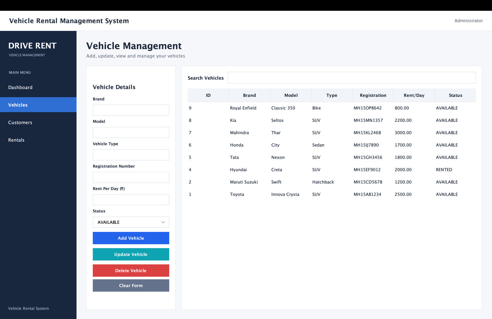
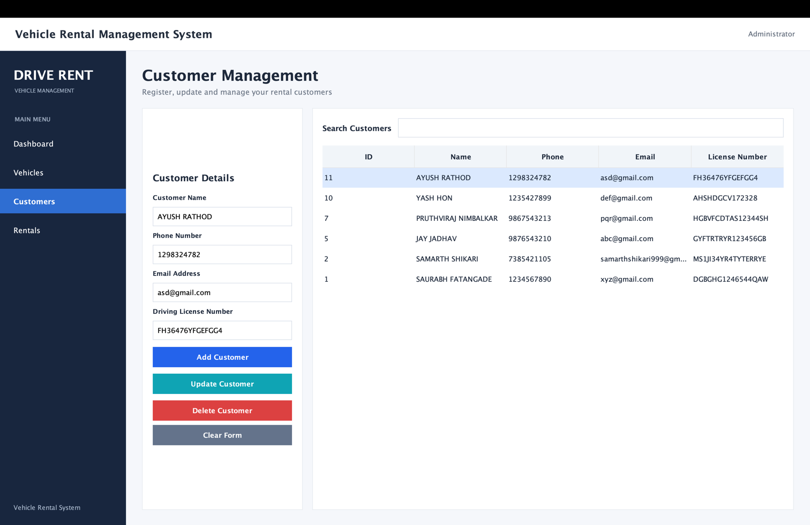
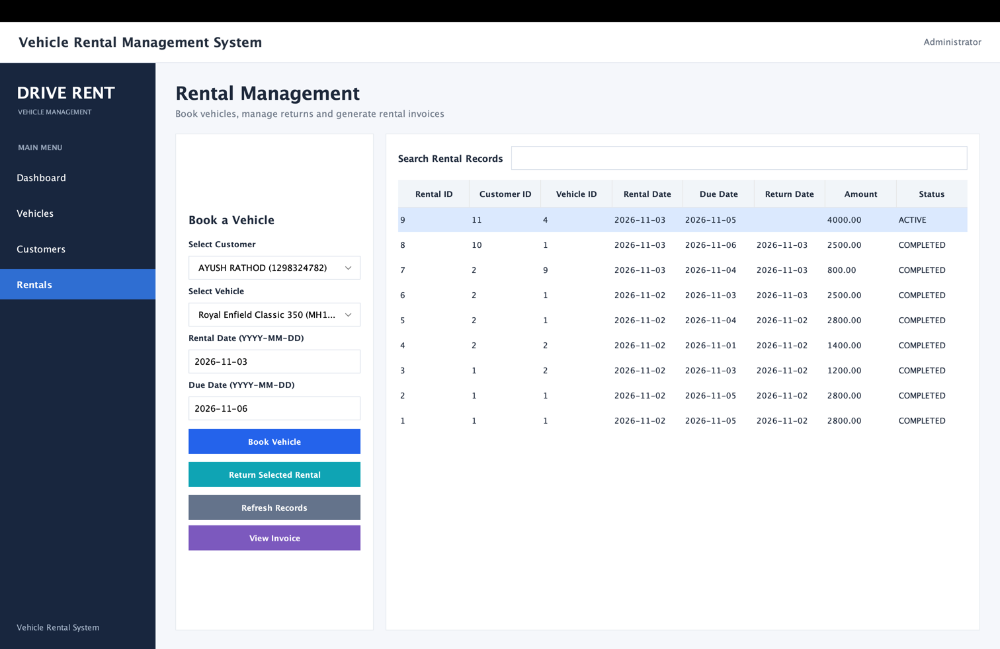
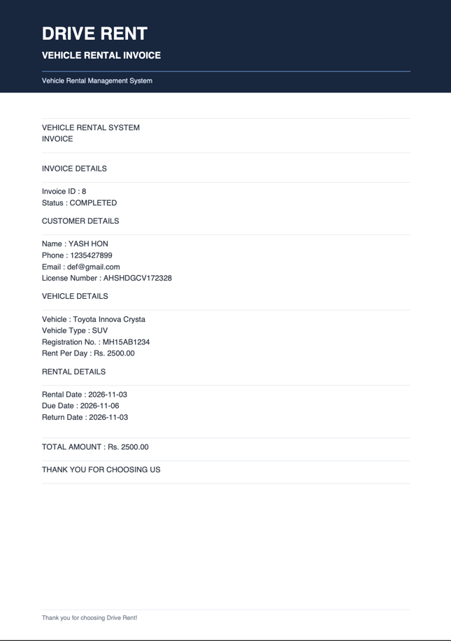

# 🚗 Vehicle Rental Management System

A Java-based desktop application developed using **Java Swing and MySQL** to simplify vehicle rental operations. The system provides an integrated interface for managing vehicles, customers, bookings, returns, rental charges, and invoices.

## ✨ Features

- **Dashboard:** View vehicle statistics, customer counts, and rental summaries.
- **Vehicle Management:** Add, update, delete, search, and view vehicle records.
- **Customer Management:** Manage customer information and driving licence details.
- **Rental Management:** Book vehicles, process returns, and track rental records.
- **Automatic Late Fee Calculation:** Calculate overdue charges at ₹200 per day.
- **Invoice Generation:** View, print, and export completed rental invoices as PDF.
- **MySQL Database Integration:** Store and manage application data.
- **Modern GUI:** Clean desktop interface built with Java Swing and FlatLaf.

## 🛠️ Technologies Used

| Technology | Purpose |
|---|---|
| Java 21 | Core programming language |
| Java Swing | Desktop GUI |
| MySQL 8 | Database management |
| JDBC | Database connectivity |
| Maven | Dependency and build management |
| FlatLaf | Modern Swing interface |
| Apache PDFBox | PDF invoice generation |
| IntelliJ IDEA | Development environment |
| Git & GitHub | Version control |

## 📁 Project Structure

```text
VehicleRentalSystem/
│
├── src/
│   └── main/
│       ├── java/com/vehiclerental/
│       │   ├── config/
│       │   ├── dao/
│       │   ├── model/
│       │   ├── service/
│       │   ├── ui/
│       │   ├── util/
│       │   └── Main.java
│       │
│       └── resources/
│           └── db.properties.example
│
├── database/
│   └── schema.sql
│
├── pom.xml
├── README.md
└── .gitignore
```


## 📸 Application Screenshots

### Dashboard


### Vehicle Management


### Customer Management


### Rental Management


### Invoice Generation

## 🗄️ Database Setup

1. Install MySQL Server and MySQL Workbench.
2. Open the project in IntelliJ IDEA.
3. Open `database/schema.sql` in MySQL Workbench.
4. Execute the SQL script to create the `vehicle_rental` database and required tables.
5. Configure your database connection.

### Database Configuration

Create a file named `db.properties` inside:

`src/main/resources/`

Add the following configuration:

```properties
db.url=jdbc:mysql://localhost:3306/vehicle_rental
db.username=YOUR_USERNAME
db.password=YOUR_PASSWORD
```

Replace the placeholders with your MySQL credentials.

**Security Note:** Never upload your actual `db.properties` file or database credentials to GitHub.

## ▶️ How to Run

### Option 1: IntelliJ IDEA

1. Clone the repository:

```bash
git clone https://github.com/samarth06s/VehicleRentalSystem.git
```

2. Open the project in IntelliJ IDEA.
3. Allow Maven to download the dependencies.
4. Set up the MySQL database.
5. Configure `db.properties`.
6. Run `Main.java`.

### Option 2: Maven Build

Open the Maven panel in IntelliJ IDEA and run:

- `clean`
- `package`

The generated JAR will be available inside the `target/` directory.

The application requires Java 21, a running MySQL server, and a valid database configuration.

## 👨‍💻 Development Team

- **Samarth Shikari**
- **Saurabh Fatangade**
- **Jay Jadhav**
- **Pruthviraj Nimbalkar**

B.Tech – Computer Science and Engineering

**Sanjivani University**

---

*Developed as a Java-based desktop application project.*
